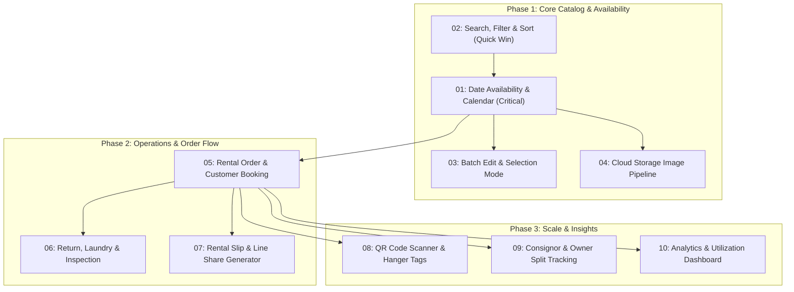

# Pending Features & Future Roadmap

This directory contains architectural specifications, user experience guidelines, data models, and implementation roadmaps for future features in **Hanger's Closet Web** (`hangerscloset-web`).

Each specification is designed to be self-contained so that a new AI agent session or engineer can pick it up immediately, trigger `/plan`, and execute implementation without missing context.

---

## Prioritization Matrix & Roadmap Overview

Features are scored using the **RICE** prioritization framework:
- **Reach (1–10)**: Volume of users, inventory items, or daily workflows affected.
- **Impact (1–3)**: Degree of business impact (1 = Moderate, 2 = High, 3 = Critical / Core).
- **Confidence (50%–100%)**: Architectural clarity and alignment with existing codebase.
- **Effort (1–5)**: Relative engineering complexity (1 = Small 1-2 days, 5 = Complex multi-system).
- **RICE Score** = $\frac{\text{Reach} \times \text{Impact} \times \text{Confidence}}{\text{Effort}}$

| Rank | Feature ID | Name | R | I | C | E | Score | Primary Benefit |
| :---: | :---: | :--- | :---: | :---: | :---: | :---: | :---: | :--- |
| **1** | [`feat-01`](./01-date-availability-and-booking-calendar.md) | **Date-Based Availability & Booking Calendar** | 10 | 3 | 90% | 3.0 | **9.0** | Core business requirement: prevents double-booking and determines item availability by rental date. |
| **2** | [`feat-02`](./02-inventory-search-sorting-and-filtering.md) | **Catalog Search, Multi-Facet Filtering & Sorting** | 10 | 2 | 95% | 2.0 | **9.5** | Fast discovery by brand, color, size, price range, and tags; activates floating bar sort button. |
| **3** | [`feat-03`](./03-batch-edit-and-selection-mode.md) | **Batch Edit & Selection Management Mode** | 7 | 2 | 90% | 2.0 | **6.3** | Replaces floating bar placeholder edit button with bulk price/status/tag updates. |
| **4** | [`feat-04`](./04-firebase-cloud-storage-image-pipeline.md) | **Firebase Cloud Storage Image Pipeline** | 8 | 2 | 90% | 2.5 | **5.8** | Eliminates inline base64/data URLs; automates compression and fast global CDN image delivery. |
| **5** | [`feat-05`](./05-rental-order-and-customer-management.md) | **Rental Order & Customer Booking Workflow** | 9 | 3 | 85% | 4.0 | **5.7** | End-to-end booking records, customer contact info, deposit tracking, and scheduled return dates. |
| **6** | [`feat-06`](./06-return-laundry-and-inspection-lifecycle.md) | **Return, Laundry & Inspection Lifecycle** | 8 | 2 | 85% | 2.5 | **5.4** | Manages garment return check-in, cleaning turnaround (`status: laundry`), and damage inspection. |
| **7** | [`feat-07`](./07-rental-slip-and-line-share-generator.md) | **Rental Slip & Line Share Generator** | 8 | 2 | 90% | 2.5 | **5.8** | Generates shareable image/PDF order slips formatted for Line chat customer confirmations. |
| **8** | [`feat-08`](./08-qr-code-scanner-and-tag-printing.md) | **QR Code Scanner & Physical Hanger Tag Printing** | 6 | 2 | 85% | 3.0 | **3.4** | Mobile camera QR code scanning for instantaneous item lookup and printable hanger labels. |
| **9** | [`feat-09`](./09-consignor-and-owner-revenue-tracking.md) | **Consignor & Owner Revenue Tracking** | 5 | 2 | 80% | 3.0 | **2.7** | Tracks earnings split for consigned dresses using the existing `owner` field on items. |
| **10** | [`feat-10`](./10-rental-analytics-and-utilization-dashboard.md) | **Rental Analytics & Utilization Dashboard** | 4 | 2 | 80% | 3.0 | **2.1** | Business intelligence: most rented dresses, revenue by brand/category, and upcoming returns. |

---

## Recommended Execution Order

---

## Instructions for New Agent Sessions

When starting work on any feature in this directory:
1. **Read the Specific Spec File**: Each markdown file (`01-*.md` to `10-*.md`) contains explicit user flows, data models, Beer CSS classes, and acceptance criteria.
2. **Review Workspace Rules**: Refer to [`architecture.md`](../../.agents/rules/architecture.md) and [`ui.md`](../../.agents/rules/ui.md).
3. **Use the Pre-Written Kickoff Prompt**: At the bottom of each feature file, there is a dedicated **Agent Kickoff Prompt**. Copy and execute that prompt to initialize planning and implementation.
4. **Follow Project Constraints**:
   - Always run in dual-mode (support both `mock` and `firebase` repositories via the repository pattern).
   - Use Beer CSS native components first; do NOT introduce radial spinners (`progress.circle`).
   - Run tests (`pnpm test`) and typecheck build (`pnpm build`) before concluding.
   - Do NOT commit to git unless explicitly ordered by the user.
